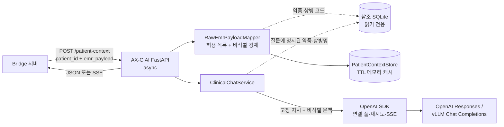
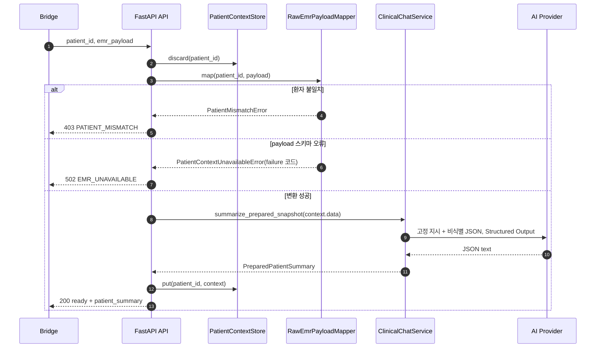
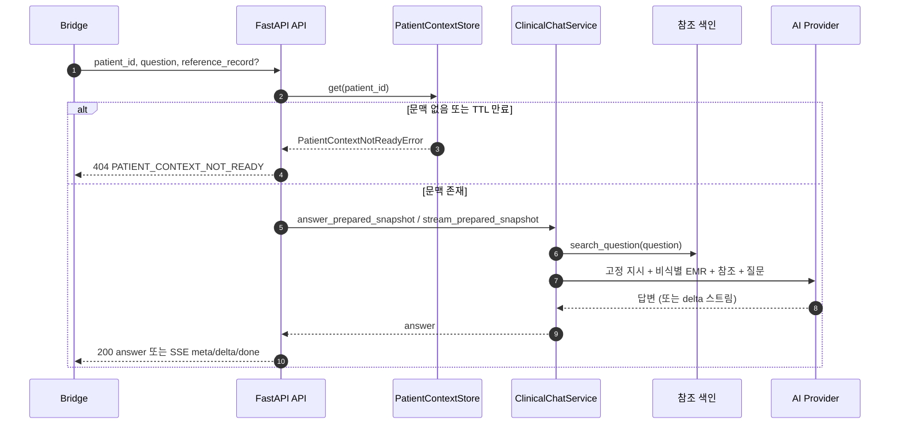

# 현재 아키텍처와 데이터 파이프라인

> 기준 코드: 2026-10-30 / 범위: `src/ax_g_ai`의 현재 구현

## 한눈에 보기

Bridge가 이미 조회한 원문 EMR을 내부 API로 전달하면, AX-G AI는 환자 ID를 대조하고
허용 목록과 비식별 처리를 거친 최소 문맥을 만든다. 이 문맥을 프로세스 메모리에 보관해 두고
AI Provider로 최초 요약과 채팅 답변을 생성한다. Provider는 OpenAI Responses API이거나
vLLM 같은 OpenAI 호환 Chat Completions 서버다. 영속 저장소와 대화 이력은 사용하지 않는다.
읽기 전용 참조 SQLite는 선택 사항이다.

Docker 구성에서는 `bridge-ai` 내부 네트워크가 Bridge와 AX-G AI를 연결하고,
`ai-provider-egress`는 AX-G AI가 Provider를 호출할 때만 쓴다.

## 모듈 구성

| 계층 | 모듈 | 책임 |
|---|---|---|
| 진입점 | `api.py` | 라우트, 요청 검증, 도메인 예외를 안전한 오류 코드로 변환, SSE 직렬화 |
| 조립 | `runtime.py`, `config.py` | `pydantic-settings`로 환경 설정 검증, 의존성 조립, 설정 오류 시 fail-closed 앱 생성 |
| 서비스 | `services/clinical_chat.py` | Provider 요청 조립, Provider 실패 분류와 로그 |
| 서비스 | `services/patient_context_store.py` | 환자별 비식별 문맥의 TTL·최대 개수 제한 메모리 보관 |
| 서비스 | `services/prepared_patient_summary.py` | 최초 요약의 Pydantic 계약: Structured Output 스키마, 응답 검증, API 본문 |
| 서비스 | `services/reference_lookup.py` | 참조 SQLite 조회. 약품·상병명은 메모리 색인으로 질문 매칭 |
| 서비스 | `services/deidentified_snapshot.py` | 식별자 키 제거 규칙(유일한 정의) |
| 서비스 | `services/clinical_calculations.py` | BMI·체표면적·CrCl 결정적 계산 보조값 |
| 어댑터 | `adapters/main_bridge.py` | 원문 EMR을 비식별 최소 문맥으로 변환하는 **유일한 PHI 경계** |
| 어댑터 | `adapters/openai.py`, `adapters/provider.py` | OpenAI SDK 기반 Responses / Chat Completions Client와 그 선택 |
| 프롬프트 | `prompts/clinical.py` | 고정 지시와 입력 템플릿 |
| 공통 | `errors.py` | API가 HTTP 상태로 바꾸는 도메인 예외 |

## 동시성과 성능 특성

- **비동기 처리**: 모든 엔드포인트가 `async`이고 Provider 호출에는 `AsyncOpenAI`를 쓴다.
  Provider 응답을 기다리는 동안 스레드를 점유하지 않는다. 그래서 동시 요청이 스레드풀
  크기(기본 40)에 묶이지 않고, 부하가 걸려도 `/health`가 지연되지 않는다.
- **연결 재사용과 재시도**: SDK Client 하나가 keep-alive 연결 풀을 공유한다. 첫 토큰을
  받기 전에 연결 오류, 429, 5xx가 나면 `AI_MAX_RETRIES`(기본 2)만큼 지수 백오프로 재시도한다.
- **참조 검색**: 시작 시 약품·상병명 목록을 메모리에 적재해 질문과 매칭하고, 필요한 참조 내용을 SQLite에서 읽는다.
- **Prefix cache**: 고정 지시와 환자 EMR을 앞에, 요청마다 달라지는 참조·형식·질문을 뒤에 둔다.
  그래서 같은 환자의 후속 질문은 Provider가 지원하는 경우 prefix cache를 재사용할 수 있다.

## 데이터 파이프라인

### A. 환자 준비: `POST /internal/v1/patient-context` (`/stream`)

`/stream` 변형은 변환 직후 문맥을 저장하고 `meta` 이벤트를 보낸 다음 요약을 스트리밍한다.
요약이 `done` 전에 실패하면 문맥을 삭제한다. `/internal/v1/emr-summary`(`/stream`)는 같은
변환을 거치지만 문맥을 저장하지 않는다.

매퍼가 정규화하는 목록은 다음과 같다. 그 밖의 최상위 필드는 `additional_clinical_data`에
보존하되 식별자 키를 재귀적으로 제거한다. 허용 필드 안에 중첩 객체가 있어도 같은 비식별
규칙을 거친다. 비어 있는 목록은 프롬프트 토큰만 늘리므로 문맥에서 뺀다.

| 원문 목록 | 내부 키 | 허용 필드/고정 단위 |
|---|---|---|
| `bloodPressureList` | `blood_pressure` | `measuredAt`, `sbp`, `dbp`, `mmHg` |
| `bloodSugarList` | `blood_sugar` | `measuredAt`, `glucoseValue`, `timingType`, `mg/dL` |
| `oxygenSaturationList` | `oxygen_saturation` | `measuredAt`, `spo2Value`, `%` |
| `labResultList` | `lab_results` | `examCode`, `itemName`, 짧은 `value`, `testDate` |
| `medicineDtailList` | `prescriptions` | 코드·명칭·분류·용량·단위·횟수·간격·기간, 참조 DB 효능·주의사항 |
| `diagnosisList` | `diagnoses` | `diagnosisCode`/`kcdCode`, 참조 DB 또는 원문 상병명 |
| `calculationContext` | `calculation_results`, `calculation_input_needed` | 결정적 계산값과 부족한 입력 안내 |

`emr_updated_at`은 허용된 측정·검사 시각 중 가장 늦은 시각이다. 그런 시각이 없으면 준비 시각(UTC)을 쓴다.

### B. 채팅: `POST /internal/v1/clinical-chat` (`/stream`)

스트리밍은 첫 delta를 받은 뒤에야 HTTP 200을 확정한다. 그 전에 실패하면 JSON 502를
반환한다. 200 이후에 실패하면 Provider 상세 없이 `error` SSE 이벤트만 보낸다.

## 보안·운영 특성

| 주제 | 현재 구현 | 주의할 점 |
|---|---|---|
| 요청 상관관계 | `X-Request-ID`를 생성·반환하고 실패 로그에 기록 | body·EMR·질문은 로그에 쓰지 않음 |
| PHI 경계 | `RawEmrPayloadMapper` 한 곳에서 허용 목록과 식별자 제거를 수행. 저장된 문맥이 곧 Provider 입력 | 새 입력 경로를 추가할 때는 반드시 이 매퍼를 거칠 것 |
| Provider 전송 | 고정 지시 + 비식별 EMR JSON 및 질문·선택적 참고 기록, OpenAI는 `store: false` | 실제 PHI를 외부로 보내기 전에 별도 개인정보·보안 승인이 필요 |
| 자격 증명 격리 | `openai_compatible`에서는 `OPENAI_*` 값과 SDK의 환경 변수 Key를 읽지 않음 | |
| 환자 혼입 방지 | 바깥 `patient_id`와 `payload.patient.patientId`를 대조하고, 준비 실패 시 이전 항목 제거 | 호출자 인증·인가는 Bridge 책임 |
| 상태 보관 | 환자별 프로세스 메모리, `AX_G_PATIENT_CONTEXT_TTL_SECONDS`(기본 12시간)·`AX_G_PATIENT_CONTEXT_MAX_ENTRIES`(기본 1000) | 재시작하면 사라지고, 다중 replica나 워커 사이에 공유되지 않음 |
| 오류 | 도메인 예외 타입을 예외 처리기에서 안전한 코드로 변환. 설정 오류는 필드명·사유만 로그 | Provider 원문 오류와 API Key를 응답·로그에 노출하지 않음 |

## 운영 수준 확장 시 다시 설계할 부분

현재 구현에는 API 자체 인증·인가, 영속 감사 저장소, 평가 승인 게이트 및 공유 환자 문맥 저장소가 없다. 운영 전환 시 다음을 검토한다.

1. Bridge 인증 정보를 API 경계에서 검증하고, 환자 준비 전에 사용자·환자 권한을 확인한다.
2. AI 호출의 시작·성공·실패를 질문·답변 원문 없이 영속 감사 저장소에 기록한다.
3. 모델·프롬프트 버전에 대한 평가 승인 게이트와 승인 지식 근거 표시가 필요한지 결정한다.
4. 프로세스 메모리 정책을 그대로 둘지, 암호화·격리·무효화를 갖춘 공유 저장소를 도입할지
   결정한다. 다중 인스턴스로 운영하려면 공유 저장소가 필요하다.

## 관련 파일

- 진입점/API: `src/ax_g_ai/api.py`, `src/ax_g_ai/runtime.py`, `src/ax_g_ai/config.py`
- 변환/비식별: `src/ax_g_ai/adapters/main_bridge.py`, `src/ax_g_ai/services/deidentified_snapshot.py`
- 채팅/요약: `src/ax_g_ai/services/clinical_chat.py`, `src/ax_g_ai/services/prepared_patient_summary.py`
- Provider 경계: `src/ax_g_ai/adapters/openai.py`, `src/ax_g_ai/adapters/provider.py`
- API 계약: `docs/contracts/bridge-ai-api-spec.md`

프롬프트는 `src/ax_g_ai/prompts/clinical.py`에서 관리한다. 환자 준비와 독립 EMR 요약은 기록된 사실을 한 줄로 요약하고 추가로 4~5줄을 요청한다. 자료가 부족하면 추가 줄 수를 줄이며 새로운 추정 진단은 제시하지 않는다. 채팅의 `question`과 `reference_record`는 매퍼를 거치지 않고 Provider에 전달되므로 Bridge에서 식별정보 포함 여부를 관리해야 한다.
